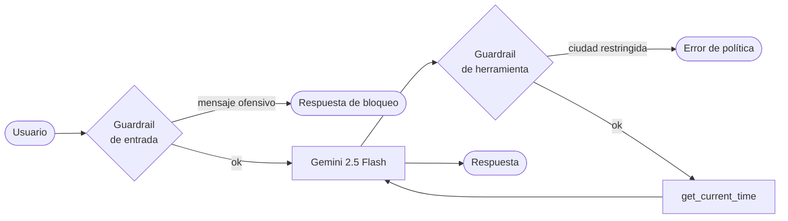

<div align="center">

# 🧠 Agentes con Google ADK

**Experimentos y patrones con el Agent Development Kit de Google sobre modelos Gemini.**


</div>

---

## ✨ Qué incluye

### `my_agent`: asistente con *guardrails*

Un agente que responde la hora actual de una ciudad mediante la herramienta `get_current_time`, protegido por dos *guardrails* implementados con *callbacks* del ADK:

| *Callback* | Cuándo se ejecuta | Qué hace |
| --- | --- | --- |
| `before_model_callback` | Antes de enviar la petición al LLM | Bloquea mensajes con lenguaje ofensivo y responde sin llamar al modelo. |
| `before_tool_callback` | Antes de ejecutar una herramienta | Aplica una política que restringe la herramienta para ciertas ciudades y devuelve un error controlado. |

Ambos registran en el estado de la sesión qué regla se activó, para trazabilidad.



## ⚡ Inicio rápido

**Requisitos:** Python 3.12+, [uv](https://docs.astral.sh/uv/) y una API key de Gemini ([Google AI Studio](https://aistudio.google.com/apikey)).

```bash
# 1. Instalar dependencias
uv sync

# 2. Configurar la API key
echo "GOOGLE_API_KEY=tu_api_key" > my_agent/.env

# 3a. Abrir la interfaz web del ADK
uv run adk web

# 3b. O conversar desde la terminal
uv run adk run my_agent
```

Ejecuta los comandos desde la raíz del repositorio: `adk web` descubre los agentes en los subdirectorios.

### Crear un agente nuevo

```bash
uv run adk create nombre_del_agente
```

Genera el paquete del agente y pide de forma interactiva el modelo y la API key.

## 📁 Estructura

```text
├── my_agent/
│   ├── __init__.py
│   └── agent.py       # Agente, herramienta y guardrails
├── pyproject.toml
└── uv.lock
```

## 📚 Recursos

- [Documentación oficial del ADK](https://google.github.io/adk-docs/)
- [Repositorio de google/adk-python](https://github.com/google/adk-python)

## 👤 Autor

**Jose Manuel Rengifo Correa** · AI Engineer
[LinkedIn](https://www.linkedin.com/in/jose-manuel-rengifo/) · [GitHub](https://github.com/joem9819)

## 📄 Licencia

Distribuido bajo la licencia MIT. Consulta [`LICENSE`](LICENSE).
